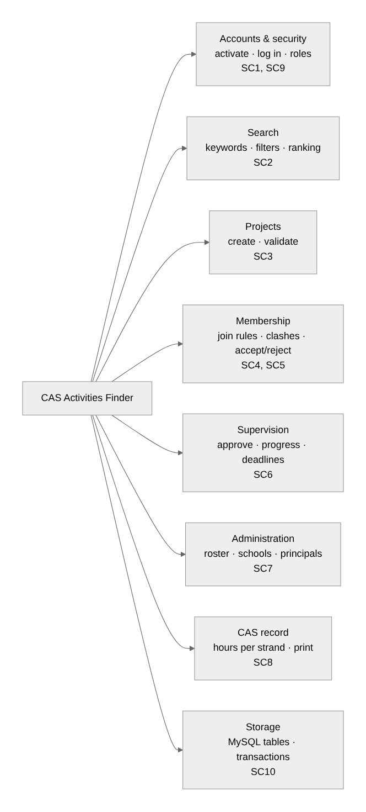

# Criterion B: Planning

## B1. Decomposition

The problem is split into eight components (Figure B1). Accounts and Storage serve all others; Projects feed Search and Membership, which with Supervision decide the CAS record.

*Figure B1: Structure chart, with the success criteria for each component.*

## B2. Development plan

| # | Task | SC | Depends on | Dates (2026) |
|---|---|---|---|---|
| 1 | Describe the problem; ask GMIS students | – | – | 3–7 Aug |
| 2 | Write measurable success criteria | all | 1 | 8 Aug |
| 3 | Design the ERD, architecture and module interfaces | all | 2 | 10–13 Aug |
| 4 | Pseudocode for the four algorithms | 2, 4, 6, 8 | 3 | 14–15 Aug |
| 5 | Wireframes and navigation map | all | 2 | 16 Aug |
| 6 | Test plan (valid, extreme, invalid) | all | 4 | 17 Aug |
| 7 | **Milestone:** tables, login, roles and first search working | 1, 2, 9, 10 | 3, 4 | 18–21 Aug |
| 8 | Create-project form with validation | 3 | 7 | 22–24 Aug |
| 9 | Search filters and ranking | 2 | 7 | 25–26 Aug |
| 10 | Join rules, clashes, locked accept/reject | 4, 5 | 8 | 27–30 Aug |
| 11 | Supervisor, principal and admin screens | 6, 7 | 8 | 31 Aug–2 Sep |
| 12 | CAS record page | 8 | 10, 11 | 3 Sep |
| 13 | Run tests T01–T30 and fix defects | all | 6–12 | 4–6 Sep |
| 14 | Record the video | all | 13 | 7 Sep |
| 15 | Evaluate each SC and write up | all | 13 | 8–13 Sep |

**Resources and constraints:** a laptop with Node.js, MySQL and VS Code; about 35 hours over six weeks. Tasks 9 and 11 are independent, so they can swap if one runs late.
