# Criterion C: System overview

*CAS Activities Finder · success criteria SC1–SC10 as defined in Criterion A*

## C1. System model

The product is a three-tier JavaScript web application (Figure C1). The browser shows a single page whose screens are drawn by `app.js`. The Express server authenticates each request, applies the rules, and is the only tier that touches the SQLite database (Figure C2). Rules are kept in pure-function modules (Figure C3) so that each one can be tested on its own.

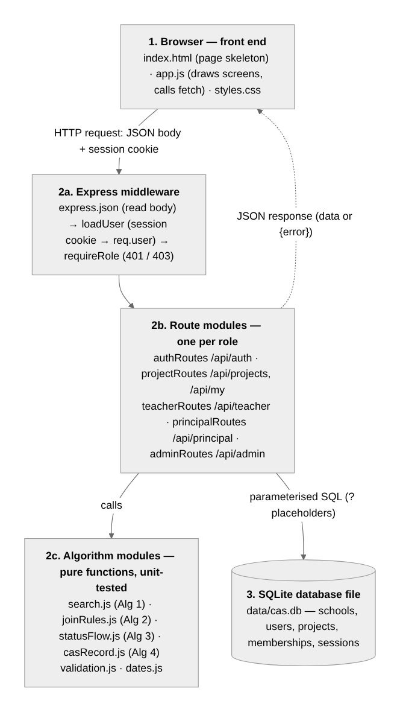
*Figure C1: Architecture, modules and API route groups.*

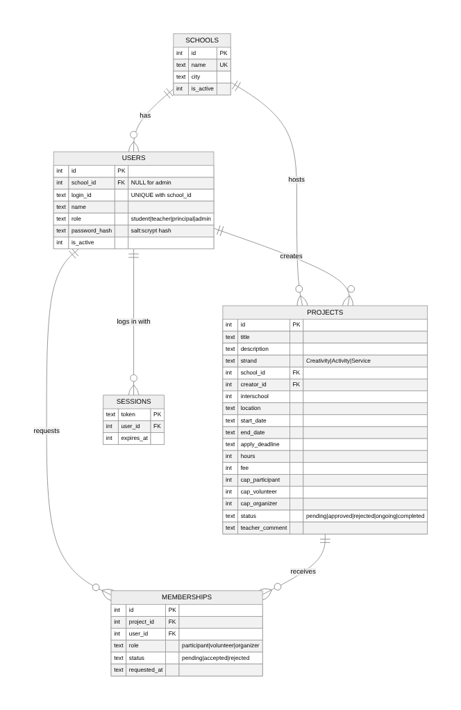
*Figure C2: Database model. MEMBERSHIPS links students and projects (many-to-many); UNIQUE(project_id, user_id) blocks duplicate requests.*

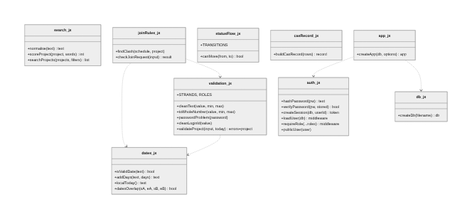
*Figure C3: Module interfaces.*

## C2. Algorithms

```
// Algorithm 1 — search and rank (SC2). Input: projects the user may see (filtered by SQL first).
FUNCTION normalise(text)
    RETURN lower case of text, accents removed, non-letters/digits → space, repeated spaces → one, trimmed

FUNCTION searchProjects(projects, query, strand, scope, openOnly, mySchool, today)
    words ← split(normalise(query), " ") without empty strings
    results ← empty list
    LOOP FOR EACH p IN projects
        IF strand ≠ "" AND p.strand ≠ strand THEN CONTINUE
        IF scope = "mine"  AND p.school ≠ mySchool THEN CONTINUE
        IF scope = "other" AND p.school = mySchool THEN CONTINUE
        IF openOnly AND p.applyDeadline < today THEN CONTINUE
        IF words is empty THEN score ← 1
        ELSE
            score ← 0
            LOOP FOR EACH w IN words
                IF w is inside normalise(p.title)           THEN score ← score + 3
                ELSE IF w is inside normalise(p.otherText)  THEN score ← score + 1
                ELSE score ← 0; EXIT LOOP                     // every word must appear
        IF score > 0 THEN append (p, score) to results
    SORT results BY score DESC, THEN startDate ASC
    RETURN results
```

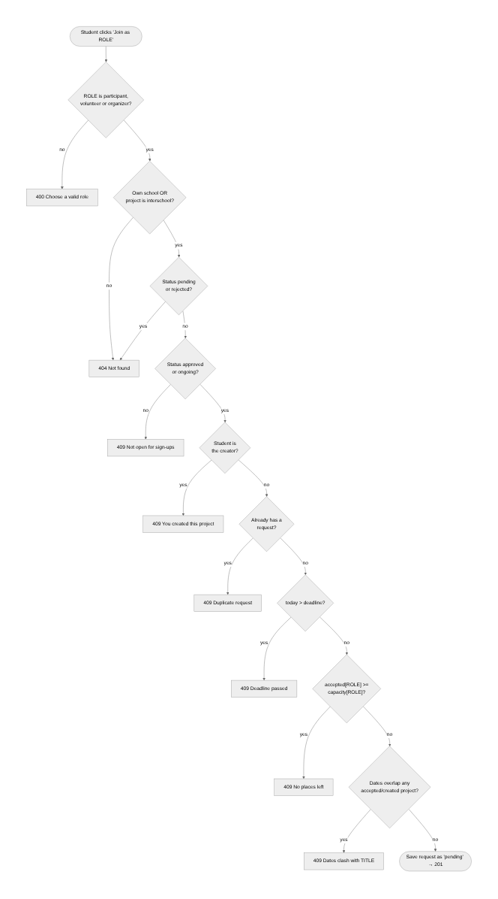
*Figure C4: Algorithm 2, join-request rules (SC4). Ranges clash when startA ≤ endB AND startB ≤ endA. Accepting a request (SC5) re-runs the capacity and clash checks.*

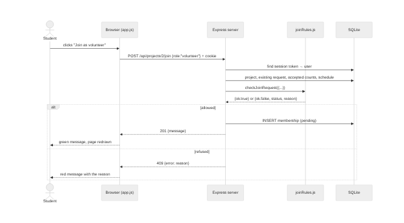
*Figure C5: A join request passing through the three tiers.*

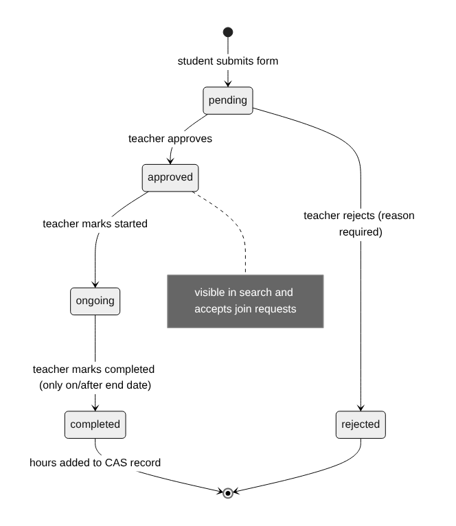
*Figure C6: Algorithm 3, project life-cycle (SC6), stored as a table of allowed next states.*

```
// Algorithm 4 — CAS record (SC8). rows = projects the student created or was accepted into.
FUNCTION buildCasRecord(rows)
    totals ← {Creativity: 0, Activity: 0, Service: 0, all: 0};  completed ← 0
    entries ← copy of rows SORTED BY startDate ASC
    LOOP FOR EACH r IN entries
        IF r.status = "completed" THEN
            totals[r.strand] ← totals[r.strand] + r.hours;  totals.all ← totals.all + r.hours;  completed ← completed + 1
    RETURN entries, totals, completed

// Algorithm 5 — authentication and authorisation (SC1, SC9)
ACTIVATE(id, password):  IF id on roster AND not activated AND password strong
                         THEN store salt + ":" + scrypt(password, salt)          // salt = 16 random bytes
LOGIN(id, password):     IF scrypt(password, storedSalt) equals storedHash (constant-time)
                         THEN token ← 32 random bytes; save (token, user, now + 8 h); set HttpOnly cookie
EVERY REQUEST:           user ← session WHERE token = cookie AND not expired AND user and school active
                         IF route needs a role: no user → 401; role not allowed → 403
```

## C3. User interface design

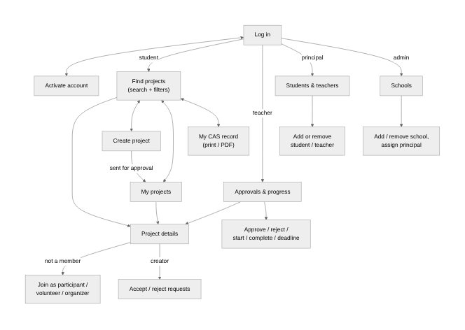
*Figure C7: Screens per role.*

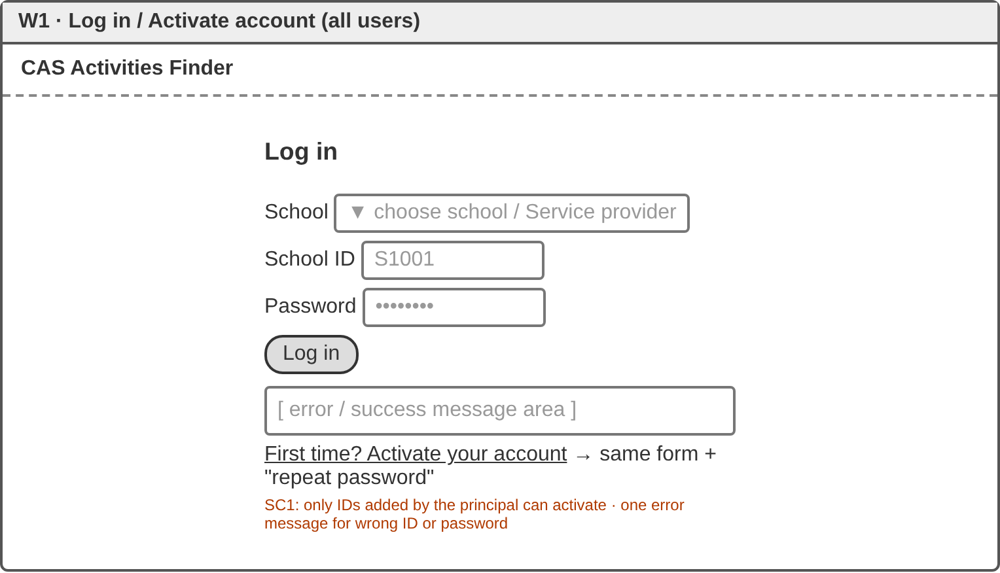
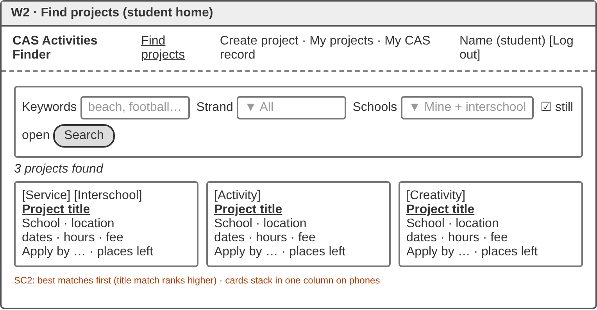
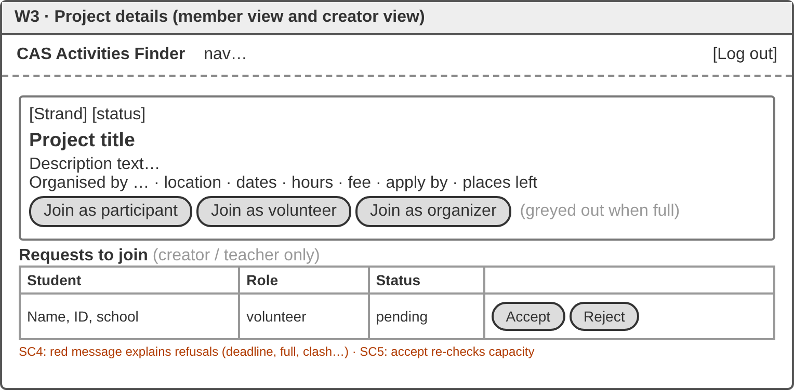
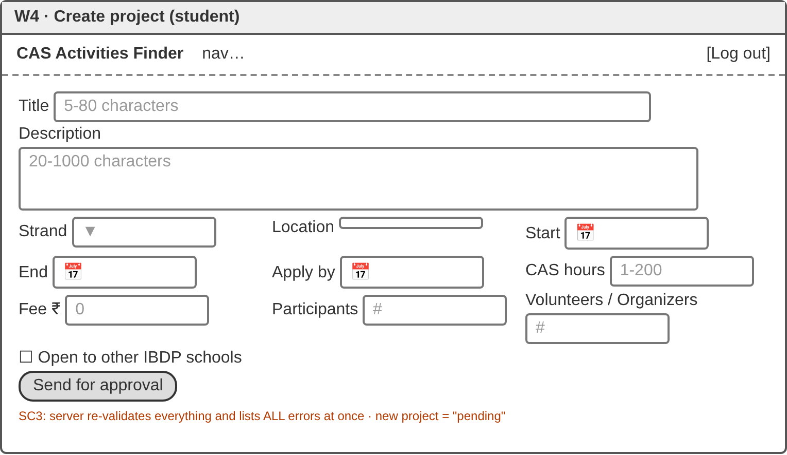
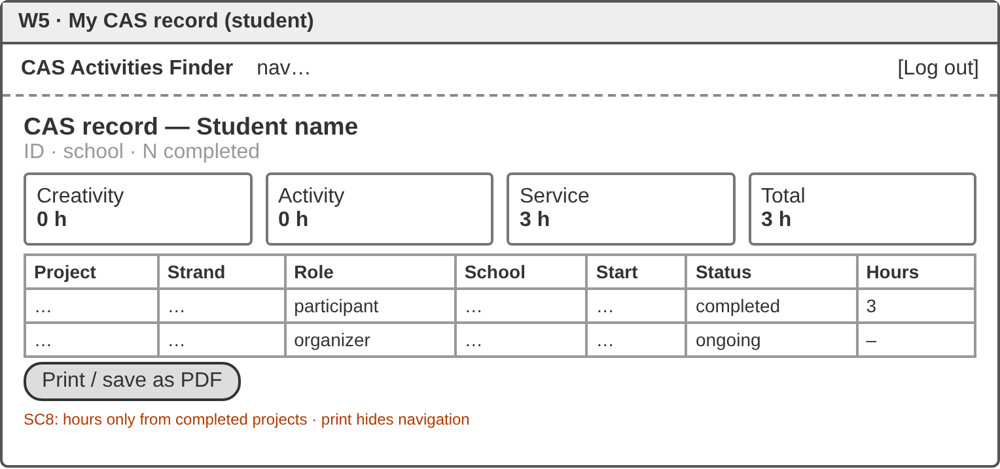
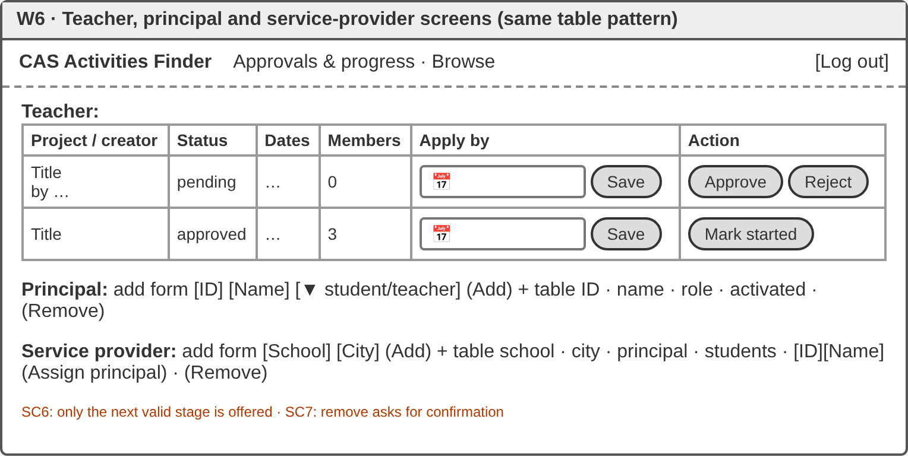
*Figures W1–W6: Wireframes, annotated with the success criterion each serves.*

## C4. Testing strategy

There are three levels of testing: unit tests on the algorithm functions, HTTP integration tests on a fresh seeded database with the date fixed at 2026-10-01, and UI tests in Chromium. Every SC has normal (N), boundary (B) and invalid (I) cases.

| Test | SC | Type | Input | Expected |
|---|---|---|---|---|
| T01 | 3 | N/B/I | 2028-02-29; 2026-02-30; 14/10/2026 | valid; invalid; invalid |
| T02 | 4 | B | ranges touching on one day; next day | clash; none |
| T03–06 | 3 | B/I | title 4/5/80/81 chars; deadline yesterday/today/after start; hours 0/4.5/200; empty form | limits accepted; others refused; all errors listed |
| T07, T15 | 1 | B/I | 8-char password; `Pass1`; unknown ID; second activation | accepted; refused |
| T16 | 1 | I | wrong password vs unknown ID | identical 401; only salt:hash stored |
| T08–10, T18 | 2 | N/I | `CLEAN`, `cafe`, `clean-up!!`, `skydiving`, blank | title match first; matched; none; all |
| T28–29 | 2 | extreme | 2,000 projects (HTTP); 20,000 (function) | < 1 s; < 0.5 s |
| T19–20 | 3 | N/I | valid project; 2 bad fields; 60 KB body | pending and hidden; 2 errors; 413 |
| T11–12, T22 | 4 | B/I | on/after deadline; last place/full; duplicate; own; clash; hidden | only valid cases accepted, with reasons |
| T23 | 5 | B/I | 2 requests, 1 place; non-creator decides | second refused; 404 |
| T13, T21 | 6 | I | skip a stage; reject without reason; complete early | refused |
| T25–26 | 7 | N/I | add duplicate ID; remove student; replace principal | 409; old cookie 401; old principal refused |
| T14, T24 | 8 | N/B | completed + ongoing; new student | completed hours only; empty |
| T17, UI | 9 | I | cross-role calls; title `` | 401/403; shown as text |
| T27 | 10 | N | restart server on the same file | data and login kept |
