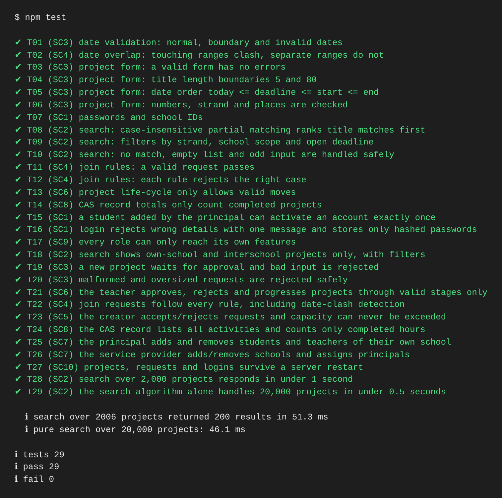

# Criterion D: Development

*Full source code is in the Appendix. Test IDs refer to Criterion C4.*

## D1. Functionality

All ten success criteria work and are shown in the video. All 30 automated tests pass (Figure D1).

| SC | Evidence | Tests |
|---|---|---|
| 1 | [login](images/ui-01-login.png) | T07, T15–16 |
| 2 | [search](images/ui-03-search.png) | T08–10, T18, T28–29 |
| 3 | [refused form](images/ui-06-create-invalid.png), [pending](images/ui-07-my-projects.png) | T01, T03–06, T19–20 |
| 4 | [joined](images/ui-04-joined.png), [clash](images/ui-05-clash.png) | T02, T11–12, T22 |
| 5 | [requests](images/ui-08-requests.png) | T23, T30 |
| 6 | [supervisor](images/ui-10-teacher.png) | T13, T21 |
| 7 | [principal](images/ui-11-principal.png), [admin](images/ui-12-admin.png) | T25–26 |
| 8 | [CAS record](images/ui-09-cas-record.png) | T14, T24 |
| 9 | [phone layout](images/ui-13-mobile.png) | T17 |
| 10 | restart shown in video | T27 |

## D2. Implementing the algorithms

### 1. Search and ranking (Algorithm 1, Appendix `src/search.js`)

```js
if (title.includes(word)) score += 3;
else if (rest.includes(word)) score += 1;
else return 0;
results.sort((a, b) => b.score - a.score || a.start_date.localeCompare(b.start_date));
```

`normalise()` lower-cases text and strips accents and punctuation, so "CLEAN", "cafe" and "clean-up!!" all match (T08). When two scores tie, `b.score - a.score` is 0, so `||` falls through to the start date. SQL first removes projects the user may not see. JavaScript then ranks the rest, because SQL `LIKE` can match words but cannot weight title matches.

### 2. Join rules and clash detection (Algorithm 2, Appendix `src/joinRules.js`)

```js
const capacity = project[`cap_${role}`];
if ((counts[role] || 0) >= capacity) return { ok: false, status: 409, reason: `There are no ${role} places left.` };
const clash = findClash(schedule, project);          // startA <= endB && startB <= endA
```

`checkJoinRequest` is a pure function: data goes in and `{ok, status, reason}` comes out. That let me test all eight rules without a server (T11–12). Building the column name from the role (`cap_${role}`) avoids three near-identical `if` statements.

### 3. Accepting inside a locked transaction (SC5, Appendix `src/routes/projectRoutes.js`)

```js
await db.transaction(async (tx) => {
  const request = await tx.get(`SELECT ... WHERE m.id = ? FOR UPDATE`, id);
  // re-check places and clashes, then UPDATE memberships
});
```

MySQL serves requests at the same time, so two creators clicking Accept together could both see one free place. `FOR UPDATE` locks the row until the transaction ends, and the capacity and clash checks run again inside it.

### 4. Life-cycle table (Algorithm 3, Appendix `src/statusFlow.js`)

`TRANSITIONS` lists each status's allowed next states, and `canMove(from, to)` checks the list. It matches Figure C6 exactly, so the code and the design can't drift apart.

### 5. Security and validation (Appendix `src/auth.js`, `src/validation.js`)

Passwords are stored as `salt:scrypt(password)`. Every route is protected by `requireRole(...)`, which returns 401 or 403. All SQL uses `?` placeholders, which stops SQL injection. User text is escaped before it is shown. `validateProject` collects every error at once, and a date is valid only if converting it back to text gives the same date (this rejects 2026-02-30).

## D3. Decisions and alternatives

| Decision | Alternative rejected | Why |
|---|---|---|
| Rank results in JavaScript | SQL `LIKE` only | `LIKE` cannot rank title matches higher |
| Row lock in a transaction | Check, then update | overbooking under simultaneous requests (T30) |
| Soft delete (`is_active = 0`) | Delete rows | keeps students' CAS history; can be undone |
| Sessions stored in MySQL | Sessions in memory | logins survive restarts (T27) |
| Plain JavaScript screens | React | no build step, and I can explain every line; but whole screens redraw |

## D4. Testing


*Figure D1: `npm test` output: 30 passed, 0 failed.*

| Test | Input | Expected | Observed | Outcome | Fix / notes |
|---|---|---|---|---|---|
| T05 | deadline = today; yesterday | accepted; rejected | accepted; rejected | Pass | – |
| T12 | last free place; role full | accepted; refused | accepted; refused | Pass | – |
| T22 | join a pending project | 404 (hidden) | 409 "not open" | Fail, then Pass | revealed hidden projects; now returns 404 |
| T30 | two acceptances at once, one place | one accepted | without lock: both accepted in 4 of 5 runs | Fail, then Pass | added `FOR UPDATE` lock |
| T17 | student calls teacher route | 403 | 403 | Pass | – |
| T28 | search among 2,006 projects | < 1 s | 87 ms | Pass | – |

**Effectiveness.** Each success criterion has at least one functional test. Each algorithm also has structural tests with valid, extreme and invalid data. Each test runs on a fresh database, so the results are repeatable. Two real defects (T22 and T30) were found by tests and not by clicking through the app, which shows the strategy worked. Its limits are that it did not test usability with real students, and it tested performance only up to 2,006 projects on one laptop.
